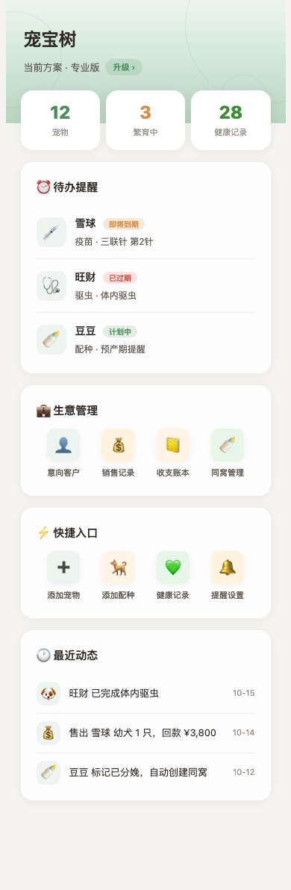
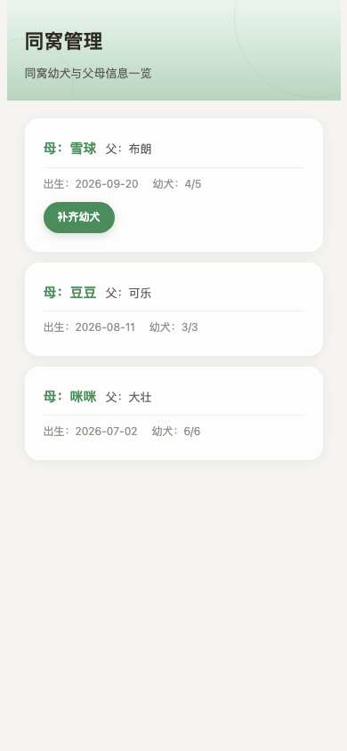

# 宠宝树微信小程序（chongbaoshu-miniapp）

> 犬舍 / 猫舍繁育者使用的**微信原生小程序**：宠物档案、繁育记录、血统谱系、证书验真、订阅，替代繁育者的 Excel 与纸本台账。

本仓库是「宠宝树」项目的小程序端（后端见 [`chongbaoshu-api`](https://github.com/genapohub/chongbaoshu-api)）。

## 这是什么

繁育者在手机上维护宠物与繁育数据的工具，与后端配合实现：

| 能力 | 说明 |
|---|---|
| 宠物档案 | 基础信息、品种、父母、免疫记录 |
| 繁育记录 | 配种、预产期、近亲检测提示 |
| 血统谱系 | 查看谱系，对外分享证书验真链接 |
| 订阅 | 三档配额，过期提示与自动降级 |
| 反馈 / 邀请 | 问题反馈、客户邀请入口 |

## 技术栈

| 层 | 选型 |
|---|---|
| 小程序 | 微信原生小程序（app.json + 原生页面，非 uni-app） |
| 页面数 | **37 个页面** |
| 后端 | [`chongbaoshu-api`](https://github.com/genapohub/chongbaoshu-api)（FastAPI） |
| 设计 | 设计系统 + 原型 HTML（见本地 `03-UI设计/`） |

## 运行截图

> 以下为小程序页面结构示意，依本仓库 `pages/` 真实 WXML/WXSS 渲染生成（非真机运行截图）。

| 首页 Dashboard | 同窝管理 |
|---|---|
|  |  |

## 本地启动

```bash
# 用微信开发者工具导入本目录（根目录含 app.json / project.config.json）
# AppID：wx217600e18466774e（需替换为你自己的测试号或正式 AppID）
# 后端地址在 config/ 或 env 中指向 chongbaoshu-api 的部署地址
```

```bash
# 如需本地构建产物
npm install && npm run build   # 视具体构建脚本
```

## 诚实边界（重要）

- **微信支付商户号未开通。** 订阅为配额模型，无真实收款；真机预览需配置合法域名与 AppID。
- **与后端联调需本地起 chongbaoshu-api。** 小程序默认请求地址需指向后端部署地址。
- 页面数与功能来自本仓库，可导入微信开发者工具预览。

## 目录结构

```text
chongbaoshu-miniapp/
├── app.json            # 全局配置（37 个页面注册）
├── app.js / app.wxss   # 应用入口与样式
├── pages/              # 各业务页面
├── images/             # 图标、Logo、TabBar 资源
├── config/             # 请求地址等配置
└── project.config.json # 微信开发者工具项目配置
```
